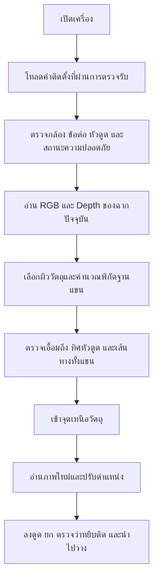

# หยิบจากกล้อง Depth โดยใช้ค่าติดตั้งที่บันทึกไว้

สถานะ: แบบเสนอเพื่อพัฒนาต่อ ยังไม่ได้เปิดการหยิบจริงหรือเปลี่ยนเงื่อนไขอนุญาต
การเคลื่อนที่ตามแบบนี้ วันที่ 2026-11-05

เป้าหมายคือเปิดเครื่องแล้วโหลดค่าติดตั้งกล้องที่ตรวจรับแล้ว ตรวจฉากปัจจุบัน
และหยิบวัตถุได้โดยไม่ต้องทำการคาลิเบรตสิบท่าทุกรอบ เมื่อย้ายแขนพร้อมกล้อง
ทั้งชุดโดยการยึดระหว่างกล้องกับแขนไม่เปลี่ยน สามารถใช้ค่าความสัมพันธ์เดิมได้
แต่ต้องสร้างข้อมูลพื้นที่และตำแหน่งวางใหม่จากสถานที่นั้น

## เหตุใด Depth เพียงอย่างเดียวยังไม่พอ

Depth และ CameraInfo ให้ตำแหน่งในกรอบกล้อง ส่วนคำสั่งเคลื่อนที่ใช้กรอบฐานแขน
สำหรับกล้องที่ติดบนแขน ต้องใช้ความสัมพันธ์ต่อไปนี้ ณ เวลาถ่ายภาพเดียวกัน:

`p_base = base_T_tool(t_capture) × tool_T_camera × p_camera`

จากนั้นชดเชยระยะหัวดูดเพื่อให้ปากหัวดูดถึงผิววัตถุ ไม่ใช่ให้จุดอ้างอิงคอนโทรลเลอร์
ไปถึงผิวนั้นโดยตรง ค่า HOME ใช้ตั้งอ้างอิงของแขน แต่ไม่บอกมุมติดตั้งกล้อง

การแปลงกล้องกับปลายแขนเป็นองค์ประกอบของ hand-eye calibration ตาม
[OpenCV](https://docs.opencv.org/4.12.0/d9/d0c/group__calib3d.html).
การใช้ transform ตามเวลาถ่ายภาพสอดคล้องกับกลไก
[ROS tf2](https://index.ros.org/p/tf2/).

## ข้อมูลสามส่วนที่ควรแยกจากกัน

| ข้อมูล | อายุการใช้งาน | เหตุให้ต้องตรวจใหม่ |
|---|---|---|
| ค่าติดตั้งกล้องกับแขนและหัวดูด | เก็บถาวรพร้อมหลักฐานและเวอร์ชัน | เปลี่ยนกล้อง/ขายึด/หัวดูด กระแทกจนตำแหน่งเปลี่ยน หรือทดสอบแล้วคลาดเคลื่อน |
| แผนที่สิ่งแวดล้อมและตำแหน่งวาง | ใช้กับสถานที่และสภาพฉากที่ตรวจแล้ว | ย้ายฐาน เปลี่ยนโต๊ะ สิ่งกีดขวางหรือภาชนะวางเปลี่ยน |
| สิทธิ์เคลื่อนที่และความพร้อมเซนเซอร์ | ตรวจสดและมีอายุสั้น | STOP, alarm, ภาพ/ตำแหน่งล้าสมัย, พื้นที่ทางเดินตรวจไม่ได้ |

การหมดอายุของความพร้อมเซนเซอร์ต้องหยุดการหยิบ แต่ไม่ควรลบหรือทำให้
ค่าติดตั้งทางเรขาคณิตที่ยังถูกต้องกลายเป็นค่าที่ต้องประมาณใหม่

## ลำดับการทำงานที่เสนอ

การใช้งานประจำไม่ควรต้องเทียบภาพกับฉากวันคาลิเบรต หรือบังคับให้ระนาบหนึ่ง
ครองสัดส่วนคงที่ของภาพทั้งเฟรม จึงจะอ่านตำแหน่งวัตถุได้ ควรตรวจข้อมูล Depth
และผิวในบริเวณวัตถุเป้าหมาย พร้อมสร้างสิ่งกีดขวางจากบริเวณโดยรอบแทน
ข้อมูลที่หาย มองไม่เห็น หรือสะท้อนไม่ควรถูกตีความว่าเป็นพื้นที่ว่าง

Magician ควบคุมตำแหน่งและ yaw ได้ การเลือกผิวดูดต้องสอดคล้องกับทิศหัวดูด
ที่เครื่องทำได้ ไม่เสนอการเอียงหัวดูดตาม normal ที่หุ่นยนต์ไม่มีแกนรองรับ

## การเปลี่ยนจากระบบปัจจุบัน

- แยกแฟ้มค่าติดตั้งที่ผ่านการตรวจรับออกจาก RGB/depth anchor ของฉากเก่า
  ใน `workflow.load_bundle`; หลักฐานทดสอบเดิมยังเก็บสำหรับ audit
- แยก `mount_calibration_valid`, `workspace_ready`, `sensors_ready` และ
  `motion_authorized` ออกจากสถานะ READY รวม โดย READY ยังต้องผ่านทุกส่วน
- เปลี่ยน startup ของ `AutomaticBackend` ให้โหลดค่าติดตั้งก่อน หากค่ามีอยู่
  และผ่านการตรวจตัวตน/ความสมบูรณ์ ให้เข้าการตรวจพร้อมใช้งาน ไม่เริ่มสิบท่า
  อัตโนมัติเพียงเพราะฉากเปลี่ยน
- แยก `ready_ttl_s` ใน `CalibrationNode.is_ready` ให้เป็นอายุของการตรวจพร้อม
  ใช้งาน ไม่ใช่อายุของค่าติดตั้ง ห้ามเพียงเพิ่ม TTL หรือคืน READY ตลอดเวลา
- คง heartbeat/STOP/ข้อมูลสดของ `PickingGuard`; ผู้อ่านแฟ้ม PASS เพียงอย่างเดียว
  ต้องไม่สามารถสั่งหยิบได้
- ใช้เส้นทาง `camera_point_to_base` และการตรวจภาพซ้ำของ `automatic_pick`
  ที่มีอยู่ ตรวจให้ตำแหน่งแขนที่ใช้ตรงกับเวลาถ่ายภาพ ไม่ใช้ตำแหน่งล่าสุดแทน
- ย้ายการตรวจระนาบและฉากเก่าเพื่อสร้าง/ทวนสอบค่าติดตั้งไปอยู่ขั้นตอนติดตั้ง
  ครั้งแรก ส่วนการหยิบใช้การตรวจคุณภาพของวัตถุและเส้นทางปัจจุบัน

## ข้อจำกัดของเครื่องนี้และงานติดตั้งครั้งแรก

ข้อมูล mount เดิมมีระยะติดตั้งและระยะหัวดูดจากการวัด แต่ยังไม่มีมุมหมุนกล้อง
กับแขนที่ผ่านการตรวจรับ และยังไม่มี calibration bundle ที่ผ่านการตรวจจริง
จึงยังแปลง Depth เป็นคำสั่งหยิบที่เชื่อถือได้โดยใช้ข้อมูลเดิมทั้งหมดไม่ได้
ต้องได้ transform นี้จากการวัด/CAD ของชุดติดตั้งที่ตรวจสอบได้ หรือจากการ
คาลิเบรตครั้งแรก แล้วตรวจความแม่นยำที่หลายตำแหน่งและหลายระดับความสูง

การย้ายทั้งชุดไม่เปลี่ยนค่าติดตั้งภายในในทางเรขาคณิต หากฐานและโครงยึดไม่บิด
และจุดอ้างอิงข้อต่อยังถูกต้อง อย่างไรก็ตาม โต๊ะใหม่ พื้นที่รอบฐานและมุมอับ
ต้องตรวจใหม่ การมองเห็นวัตถุหนึ่งจุดไม่ใช่หลักฐานว่าเส้นทางแขนทั้งหมดว่าง
จึงไม่รับรองว่าใช้งานได้ทุกสถานที่ทันทีโดยไม่มีเงื่อนไข

## เกณฑ์ตรวจรับก่อนเปิดใช้แบบใหม่

1. จุด 3D ที่รู้ตำแหน่งผ่านการแปลงพิกัดและชดเชยหัวดูดในหลายท่าและหลายความสูง
   รวมถึงขอบเขตพื้นที่ใช้งานจริง โดยกำหนดค่าคลาดเคลื่อนจากงานหยิบที่ต้องการ
2. ปิดเปิดเครื่องและเปลี่ยนฉากแล้วค่าติดตั้งยังใช้ได้ โดยไม่เริ่มเคลื่อนสิบท่าเอง
3. กล้อง/ขายึด/หัวดูดเปลี่ยน แฟ้มเสียหรือไม่ตรงอุปกรณ์ ต้องปฏิเสธการหยิบ
4. ข้อมูล RGB-D หรือ TF ล้าสมัย ขาดหาย หรือเวลาคลาดเคลื่อน ต้องหยุดก่อนส่ง goal
5. พื้นที่ไม่เห็น สิ่งกีดขวาง หรือท่าที่แขนเอื้อมไม่ถึง ต้องไม่สร้างคำสั่งหยิบ
6. STOP/alarm ระหว่างวางแผนและเคลื่อนที่ต้องหยุดได้ และห้ามนำ authorization เก่า
   กลับมาใช้หลังรีสตาร์ต
7. ย้ายชุดแขนและกล้องไปฉากทดสอบใหม่: ใช้ค่าติดตั้งเดิม สร้างแผนที่และเป้าหมายใหม่
   และทวนสอบความแม่นยำก่อนเปิดการหยิบจริง
