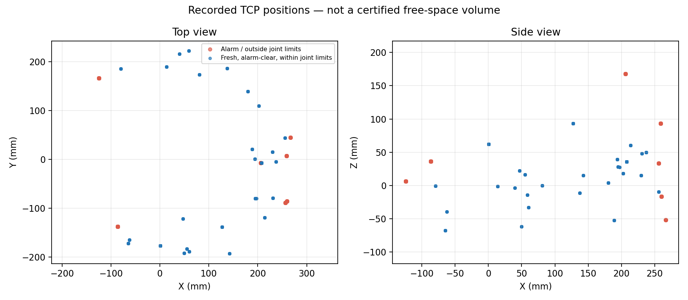

# Manual movement recording results

Recording stopped: operator_requested. Duration: 153.5 s.
Samples: 765 total; 656 fresh, alarm-clear and within configured joint limits.
Excluded: 81 alarm/invalid samples and 28 additional joint-limit violations.

| Axis | Minimum (mm) | Maximum (mm) |
| --- | ---: | ---: |
| X | -79.63 | 255.86 |
| Y | -192.35 | 221.78 |
| Z | -67.95 | 93.45 |

| Joint | Minimum (degrees) | Maximum (degrees) |
| --- | ---: | ---: |
| J1 | -110.73 | 113.24 |
| J2 | 13.61 | 68.18 |
| J3 | 11.52 | 63.98 |
| J4 | 0.00 | 0.00 |

Alarm sample counts: {"48": 47, "40": 19, "45": 15}. Counts are samples, not distinct incidents.

## Interpretation

- Extrema occur at different poses; their bounding box does not certify its interior or a route between them.
- Only controller TCP/joint feedback was recorded, not the exterior of the camera, suction tool, brackets or cables.
- Alarm-clear feedback and joint-limit compliance alone do not prove collision clearance.
- Observed Z is the controller TCP coordinate, not a measurement of table height.
- Joint 4 remained at zero; this recording does not measure clearance during independent wrist rotation.
- Configured sphere/table policy with table Z=-58 mm requires TCP Z>=120.6 mm; no filtered sample reaches this height.

No robot movement was commanded by the recorder. No runtime workspace was created or approved.

Sources: [raw samples](samples.jsonl), [processed result](processed.json), [status after recording](status-after-recording.json).

## Operator-authorized hardware retry

The operator explicitly authorized real hardware testing after this recording.
The measured ranges and instruction are saved in
[operator-authorized-retry.json](operator-authorized-retry.json). No additional
operator permission was requested for the retry.

The live commissioning preparation service accepted a new request, run
`82d2c14ee3ac4352ab80166c7c05b8a2`. It reached FAULT at
WORKSPACE_NOT_CONFIGURED. Its diagnostics also reported insufficient valid
depth pixels, unstable depth and a missing scene baseline. The subsequent
depth sample had a valid ratio of 0.0740. Accepted calibration poses remained
zero, motion_command_sent was false and PTP restoration was NOT_REQUIRED.
See [runtime result](authorized-retry-result.json).

An independent read-only diagnostic tested the recorded TCP bounding box
against the configured attachment sphere and all eight planner variants.
Zero variants passed; diagnostic exit code 1 means geometry rejection.
The input explicitly labels the box as observed TCP extrema, not surveyed
free space. At the current TCP Z of 35.779 mm, the conservative table
clearance policy requires another 84.821 mm of height; this is a model
diagnostic, not a command to raise the arm or evidence of physical contact.
See [geometry audit](tcp-box-audit.json). No runtime workspace, synthetic
measurement or validated-plan authorization was created.

## Confirmed installation bounds

The operator subsequently confirmed both the installation inspection and that
X170–230, Y−70–70, Z50–120 mm are the actual entire free-volume boundaries.
This confirmation is saved in [operator-installation-confirmation.yaml](operator-installation-confirmation.yaml).
There is no outstanding question about the scope of these numbers. Their
geometric incompatibility with the configured attachment envelope remains.

An additional manufacturer-specification check illustrates the clearance
problem independently of the large camera-envelope sphere: DOBOT specifies a
20 mm diameter for its standard vacuum suction cup
([official specification](https://www.dobot-robots.com/products/education/magician.html)).
For that standard cup in its normal vertical orientation, the configured
25 mm clearance on each side requires at least 20 + 2 x 25 = 70 mm in X,
before uncertainty, brackets or camera are included. The confirmed box is
only 60 mm wide in X. This is a conditional check using the manufacturer's
standard-cup dimensions, not a new physical measurement of the installed cup.
No runtime safety threshold was reduced and no movement was commanded.
