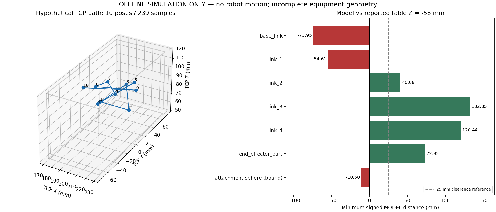

# ผล Dry-run / Simulation ของ Calibration 10 ท่า

ผู้ใช้ยืนยันว่า X170–230, Y−70–70, Z50–120 mm เป็น **ช่วง TCP สมมติสำหรับ Simulation**
ไม่ใช่ measured free volume และไม่ใช่ collision envelope
แก้แบบฟอร์ม Workspace ให้ free_volume_min/max เป็น null แล้ว คง verified flags เป็น false
ไม่มีการสร้างไฟล์ Workspace ของ runtime

## วิธีทดสอบ

- ใช้ `automatic_plan()` เดิมกับ Anchor สมมติ `[190,0,85,0]` mm/deg
  เลือกเพื่อให้แผน nominal อยู่ในช่วงสมมติ ไม่ใช่ตำแหน่งที่วัดจริงหรือแผนที่อนุญาต
- ใช้ IK เดิม `calc_inv_kin`, controller Cartesian limits รวม coupled J3/Yaw
  และ Automatic soft margin 2° ไม่ลด threshold
- MOVL ตรวจครบ 10 segments รวม stationary anchor, 239 samples
  ระยะ sample ไม่เกิน 2 mm / 2° และรวม endpoints ใช้ yaw interpolation ทางสั้น
- ใช้ `PyBulletCollisionServer` เดิมใน DIRECT mode แยกจาก ROS/ฮาร์ดแวร์
  ตรวจ collision shapes ของ suction-cup URDF พร้อม signed closest-point distances
  (ระยะ query 2 m) ของทุก link กับโต๊ะ และ nonadjacent self pairs
- เปรียบเทียบระนาบพื้นเดิมในโมเดล Z=-131.305 mm กับ table Z=-58 mm ที่ผู้ควบคุมยืนยัน
  เปลี่ยนตำแหน่งระนาบเฉพาะใน PyBullet process ไม่แก้ production config
- ชุดกล้อง/ขายึด/สายไม่มี mesh ครบ จึงตรวจทรงกลม envelope เดิมรัศมี 152.6 mm
  รวม translation uncertainty 1 mm และตรวจ margin 25 mm แยกต่างหาก

ไม่มี ROS init/service/action หรือ Motion Goal จากสคริปต์ Simulation
การอ่าน runtime หลังจบเป็น HTTP GET เท่านั้น
นี่เป็นการตรวจ geometry แบบ quasi-static ไม่มีเวลาเคลื่อนจริง การวิเคราะห์ dynamics หรือ RGB-D capture

## แผนสมมติที่ทดสอบ

| Pose | X mm | Y mm | Z mm | J4 deg |
| --- | ---: | ---: | ---: | ---: |
| 1 | 190 | 0 | 85 | 0 |
| 2 | 225 | 0 | 85 | 0 |
| 3 | 205 | 30 | 95 | 0 |
| 4 | 205 | -30 | 100 | 0 |
| 5 | 220 | 20 | 105 | 15 |
| 6 | 220 | -20 | 110 | -15 |
| 7 | 185 | 25 | 95 | 10 |
| 8 | 200 | -25 | 115 | -10 |
| 9 | 225 | 15 | 100 | 20 |
| 10 | 185 | -25 | 110 | -20 |



## ผลตรวจ

| การตรวจ | ผลและขอบเขต |
| --- | --- |
| IK + controller limits + soft limits | PASS ทุก sample |
| TCP สมมติอยู่ในช่วงที่กำหนด | PASS ทุก sample |
| Collision pairs ตามนโยบายเดิมและพื้นเดิม | PASS เฉพาะ pairs ที่โมเดลเดิมตรวจ |
| Expanded nonadjacent self distances | ต่ำสุด 37.56 mm ระหว่าง link_3 กับ end_effector_part; ไม่มี penetration ใน pairs ที่ตรวจ |
| URDF articulation limits | FAIL: joint_3 ถึง -32.057° ขณะที่ lower limit ใน URDF=-15° |
| โมเดลทุก link กับ table Z=-58 mm | FAIL ตามโมเดล: base และ link_1 ทับระนาบโต๊ะ |
| Attachment sphere กับโต๊ะ | ไม่ผ่าน conservative clearance |
| อุปกรณ์ทั้งหมดและ continuous collision safety | NOT VERIFIED |

Controller ใช้มุม Dobot ส่วน collision model ใช้ `q3 = controller_J3 - controller_J2`
ดังนั้นข้อขัดแย้ง joint_3 ต้องตรวจ mapping/limit convention ของโมเดลก่อน
ไม่ใช่หลักฐานว่าข้อต่อจริงเกิน limit ของ controller และห้ามแก้ limit เพื่อให้ผ่านโดยไม่มีหลักฐาน

## ระยะต่ำสุดรายชิ้นส่วน

ระยะต่อไปนี้เป็น **signed model distance** ที่ sample ตลอดเส้นทางถึงโต๊ะ Z=-58 mm
ค่าติดลบคือ penetration ของโมเดลกับระนาบ ไม่ใช่การตรวจพบการชนจริงจากฮาร์ดแวร์

| Collision shape | ระยะต่ำสุด mm |
| --- | ---: |
| magician_base_link | -73.95 |
| magician_link_1 | -54.61 |
| magician_link_2 | 40.68 |
| magician_link_3 | 132.85 |
| magician_link_4 | 120.44 |
| end_effector_part | 72.92 |
| ทรงกลมครอบอุปกรณ์ รวม uncertainty | -10.60 |

ทรงกลมขาด clearance 25 mm รวม **35.60 mm** ไม่ได้พิสูจน์ว่าชิ้นส่วนจริงชน
ระยะทรงกลมถึงระนาบคำนวณจาก Z ต่ำสุดของ MOVL และ endpoints จึงให้ conservative bound
ต่อเนื่องของ sphere/table ได้ แต่ไม่รับรอง continuous mesh collision หรือสภาพแวดล้อมจริง
**ระยะต่ำสุดจริงของอุปกรณ์ทั้งหมด: ยังระบุไม่ได้** เพราะ geometry/สิ่งกีดขวางไม่ครบ

พื้นใน validator เดิมอยู่ -131.305 mm ต่างจากค่าที่รายงาน 73.305 mm
แม้ที่พื้นเดิม base mesh มี penetration ประมาณ 0.65 mm (อาจรวม collision margin/mesh)
ต้องเทียบ datum และ collision shape ก่อนตีความเป็นระยะจริง

## ข้อจำกัดของโมเดลที่ต้องแก้ก่อนทดสอบเคลื่อนจริง

1. เทียบ Controller frame, table datum และ URDF collision frame ให้ตรงกันด้วยหลักฐาน
   ไม่ปรับ table Z กลับเป็นค่าโรงงานในโมเดลเพียงเพื่อให้ test ผ่าน
2. ตรวจ mapping ของมุม controller ไป articulation และ limit ของ joint_3 ใน URDF
3. เพิ่มหรือยืนยัน geometry ของกล้อง ขายึด สาย ท่อ และ J4 yaw sweep
   collision URDF ปัจจุบันไม่มี yaw joint ของชุดปลายแขนครบ
4. ต้องมี measured free volume/สิ่งกีดขวางจริงและ validated allowed-collision pairs
   adjacent mechanical contacts ถูกละจาก expanded pair audit ตามนิยามการตรวจ
5. ตรวจเส้นทางจาก Anchor จริงใหม่ (ปัจจุบันประมาณ X149.93 Y0 Z99.89 mm)
   Simulation นี้เริ่มจาก Anchor สมมติ จึงยังไม่ตรวจทางเข้าไปยังจุดนั้น
6. เมื่อ geometry และแผนจริงผ่าน จึงผูก operator authorization กับ plan fingerprint
   และทดสอบ Commissioning Pose 1→2 พร้อม E-stop, feedback, capture, restore ตาม workflow เดิม

## Tests และหลักฐาน

**118 passed, 0 failures, 0 errors, 0 skipped**, 45.972 s
รัน ROS tests ใน ROS_DOMAIN_ID=173 รวม 6 suites เดิม, collision/validator regressions
และ 4 tests ใหม่สำหรับ sampling/yaw, simulation-only gate และ signed distance จาก box/plane ที่รู้ระยะ
PASS นี้เป็นผล software tests ไม่ใช่ commissioning หรือ geometry safety PASS

หลังทดสอบ: `REAL_MOTION_READY=false`, `GEOMETRY_VERIFIED=false`, active_goal=false
TCP จริงยังประมาณ X149.93 Y0 Z99.89 mm; ไม่มี runtime workspace file
Motion Command Sent: FALSE; Runtime/Safety Interlocks: ไม่เปลี่ยน
Commissioning COMPLETE: FALSE; Calibration captures/metrics: ไม่มีจาก Simulation

- [ผล simulation ราย sample/segment และ minima](simulation-tcp-2026-10-11/results.json)
- [ผล tests](simulation-tcp-2026-10-11/tests.xml)
- [runtime หลังทดสอบ](simulation-tcp-2026-10-11/runtime-after.json)
- [scenario สมมติ](simulation-tcp-scenario-2026-10-11.yaml)
- [สคริปต์](../scripts/simulate_calibration_geometry.py)

รันซ้ำด้วย ROS Jazzy และ workspace environment ที่ build แล้ว:

```bash
source /opt/ros/jazzy/setup.bash
source install/local_setup.bash
python3 scripts/simulate_calibration_geometry.py --output /tmp/tcp-simulation-results.json
```

Exit 0 ของสคริปต์หมายถึงสร้างรายงานสำเร็จ ไม่ใช่ safety approval
